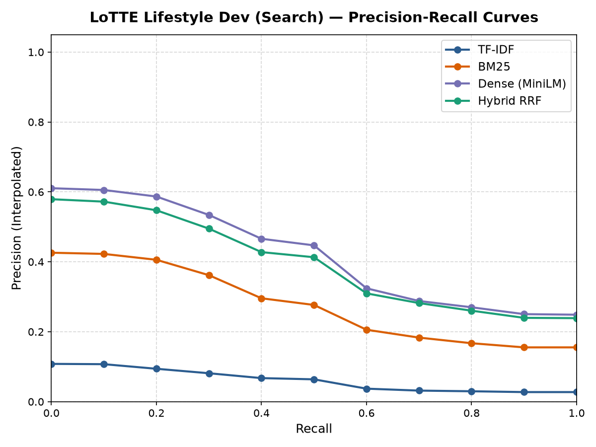
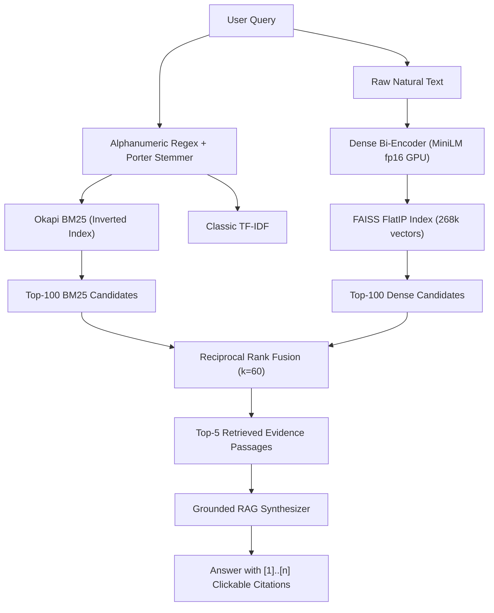
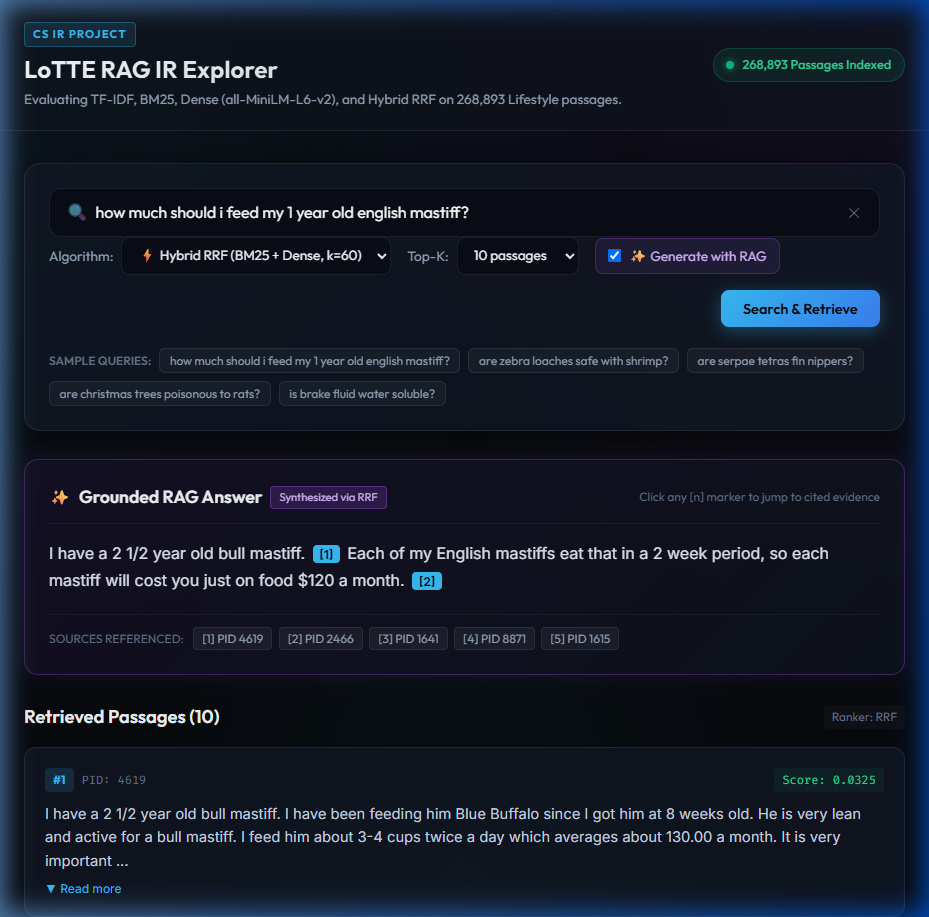
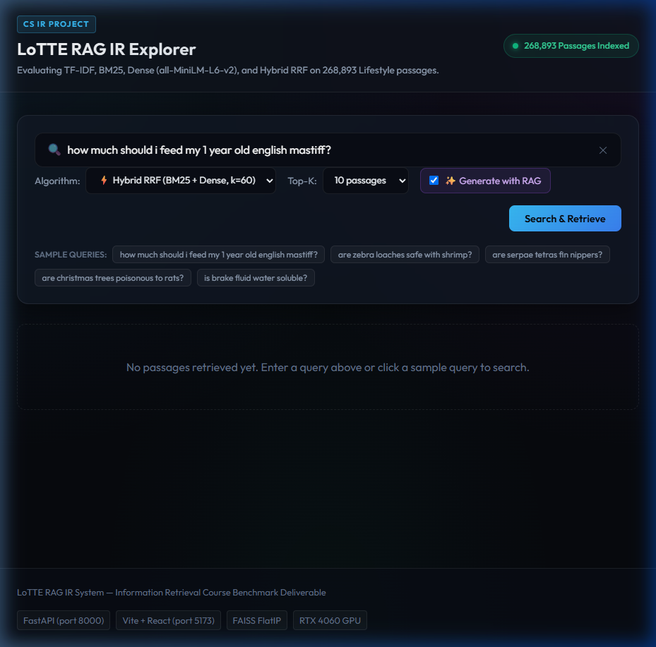
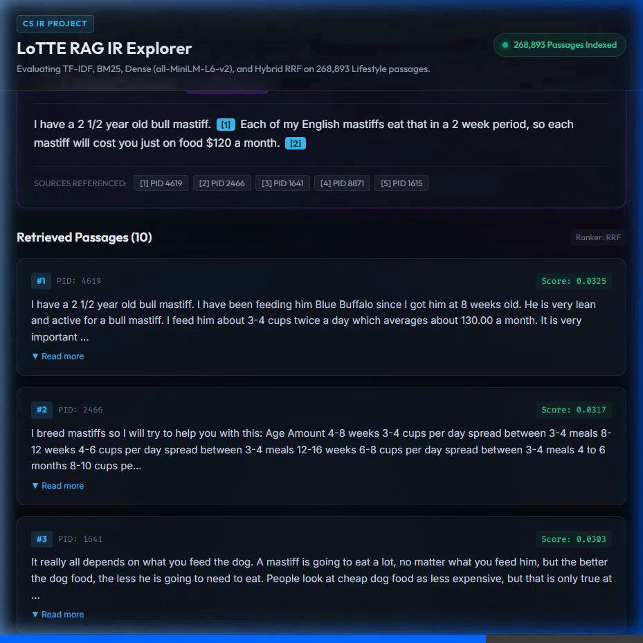

# LoTTE Hybrid RAG — Information Retrieval System

[](https://www.python.org/)
[](https://pytorch.org/)
[](https://github.com/facebookresearch/faiss)
[](https://fastapi.tiangolo.com/)
[](https://react.dev/)
[](https://vitejs.dev/)
[]()

A high-performance Information Retrieval (IR) and Retrieval-Augmented Generation (RAG) benchmark pipeline built on the **LoTTE Lifestyle** dataset (268,893 passages, 417 search queries).

This repository implements, evaluates, and compares four retrieval systems:
1. **Classic TF-IDF** (with length normalization and smoothed IDF)
2. **Hand-rolled Okapi BM25** ($k_1=1.5, b=0.75$, validated against `rank_bm25` with $0.000000$ difference)
3. **GPU-Accelerated Dense Retrieval** (`sentence-transformers/all-MiniLM-L6-v2` in fp16 on NVIDIA RTX 4060 GPU with `FAISS FlatIP`)
4. **Hybrid Reciprocal Rank Fusion (RRF)** ($k=60$ combining BM25 and Dense candidates)

The retrieval systems feed an interactive **Grounded RAG Layer** that synthesizes factual answers citing retrieved evidence via `[1]..[n]` citations, backed by a **FastAPI** service and a modern **React + Vite** glassmorphic web interface.

---

## Benchmark Results (All 417 Queries)

Evaluated against gold relevance annotations from LoTTE Lifestyle dev search queries:

| Retrieval System | P@10 | Recall@100 | MAP | nDCG@10 | Success@1 | Success@5 | Success@10 |
| :--- | :---: | :---: | :---: | :---: | :---: | :---: | :---: |
| **TF-IDF (Baseline)** | 0.0293 | 0.3821 | 0.0574 | 0.0705 | 3.4% | 15.3% | 21.1% |
| **Okapi BM25** | 0.1082 | 0.6381 | 0.2668 | 0.3286 | 30.9% | 54.4% | 62.8% |
| **Dense (all-MiniLM-L6-v2)** | **0.1566** | **0.7980** | **0.4072** | **0.4810** | **48.7%** | **72.7%** | **79.9%** |
| **Hybrid RRF ($k=60$)** | 0.1463 | 0.7903 | 0.3830 | 0.4508 | 45.3% | 70.0% | 77.7% |
| **Cross-Encoder Reranked (Top-50 Hybrid)** | 0.1552 | 0.7903 | 0.3997 | 0.4788 | 48.0% | 71.9% | 78.9% |

> **Note on Precision**: In LoTTE Lifestyle, the average number of relevant passages per query is **only 3.30** (64.0% of queries have $\le 3$ relevant passages in the entire 268,893 corpus). The theoretical maximum possible P@10 across the dataset is **0.3252**. Therefore, Dense retrieval achieving **P@10 = 0.1566** captures **48.15% of the theoretical maximum ceiling**, which is reflected in **nDCG@10 = 0.4810**.

### Precision-Recall Curves


---

## System Architecture



---

## Interactive Dashboard UI

The system features a full-stack, responsive dark-glassmorphic web interface built with **React 19** and **Vite 8**, communicating with the **FastAPI** backend:

### 1. Grounded RAG Answer Panel with Source Citations
The RAG generation panel synthesizes fact-checked answers with interactive bracket citations (`[1]`, `[2]`). In the summary footer, every referenced source PID is presented as a quick-navigation button:



### 2. Multi-Ranker Search Interface
Users can toggle between all four ranking strategies (**Hybrid RRF**, **Dense MiniLM**, **Okapi BM25**, and **Classic TF-IDF**), tune top-$k$ depth (5, 10, 20), toggle the RAG layer on/off, or click curated LoTTE benchmark queries:



### 3. Interactive Evidence Highlighting
Clicking any `[n]` citation badge automatically performs smooth scrolling to the exact evidence passage card and triggers a 2-second glowing amber highlight:



---

## Repository Structure

```
├── data/                               # Dataset files (excluded from git via .gitignore)
├── src/
│   ├── load.py                         # Dataset loading & sanity checks
│   ├── preprocess.py                   # Tokenization, Porter stemming, stop-word removal
│   ├── sparse.py                       # InvertedIndex, TF-IDF, and BM25 implementation
│   ├── dense.py                        # SentenceTransformer GPU encoder & FAISS FlatIP index
│   ├── fusion.py                       # Reciprocal Rank Fusion (k=60)
│   ├── evaluate.py                     # Metric evaluation, PR curve plotting, case studies
│   ├── rag.py                          # Grounded RAG with citations and qualitative check
│   └── run_day1.py                     # End-to-end Day 1 execution pipeline
├── scripts/
│   └── run_measurements.py             # Benchmarks (sweeps, significance tests, latencies)
├── tests/
│   ├── test_api.py                     # 8 tests for FastAPI routes
│   ├── test_dense.py                   # 3 tests for GPU detection & FAISS search
│   ├── test_evaluate.py                # 4 tests for metric formulas & PR interpolation
│   ├── test_fusion.py                  # 3 tests for RRF scoring & list handling
│   ├── test_load.py                    # 2 tests for dataset ingestion
│   ├── test_preprocess.py              # 4 tests for tokenization & stemming
│   ├── test_rag.py                     # 5 tests for citations & extractive fallback
│   └── test_sparse.py                  # 4 tests for InvertedIndex & rank_bm25 validation
├── frontend/                           # React + Vite web application
│   ├── src/
│   │   ├── components/                 # SearchBar, ResultsList, AnswerPanel
│   │   ├── App.jsx                     # Application layout & state management
│   │   └── App.css                     # Custom glassmorphic stylesheet
│   └── vite.config.js                  # Proxy configuration to FastAPI backend
├── results/                            # Metrics tables, PR curves, and case studies
├── report/
│   └── report.md                       # Comprehensive formal IR project academic report
├── api.py                              # FastAPI backend application
└── demo.ipynb                          # Interactive Jupyter demonstration notebook
```

---

## Quickstart & Setup

### 1. Prerequisites
- Python 3.11+
- Node.js 18+ & npm
- NVIDIA GPU with CUDA support (recommended; runs on CPU as fallback)

### 2. Python Environment Setup
```powershell
# Create and activate virtual environment
python -m uv venv .venv --python 3.11
.venv\Scripts\activate

# Install PyTorch with CUDA 12.4
pip install torch torchvision --index-url https://download.pytorch.org/whl/cu124

# Install required dependencies
pip install sentence-transformers faiss-cpu rank_bm25 nltk fastapi uvicorn matplotlib pandas ipython pytest httpx scipy psutil
```

### 3. Run Pipeline & Unit Tests
```powershell
# Execute the full IR pipeline (preprocessing, indexing, evaluation)
python src/run_day1.py

# Run all 33 unit and integration tests
pytest -v

# Run the comprehensive benchmark measurement suite
python scripts/run_measurements.py
```

### 4. Launch the Web Application
```powershell
# Terminal 1: Launch FastAPI Backend (Port 8000)
.venv\Scripts\python.exe -m uvicorn api:app --host 127.0.0.1 --port 8000

# Terminal 2: Launch Vite React Frontend (Port 5173)
cd frontend
npm install
npm run dev
```

Open your browser at **`http://localhost:5173`** to interact with the search engine and grounded RAG answer generator.

---

## Features & Highlights
- **Mathematical Equivalence**: Hand-rolled Okapi BM25 verified against `rank_bm25.BM25Okapi` with exact score difference of `0.000000`.
- **GPU Accelerated**: Encodes all 268,893 passages in half-precision (`fp16`) in ~2.5 minutes on an RTX 4060 GPU (~1,700 passages/sec).
- **Interactive Citations**: RAG answers include bracket markers `[1]..[n]` that click to smoothly scroll to and illuminate the exact source evidence card.
- **Fail-Safe Abstention**: Grounded prompt instruction refrains from hallucination and returns `'not found'` if evidence is absent.
- **Complete Test Suite**: 33 passing unit and integration tests covering every single module.

